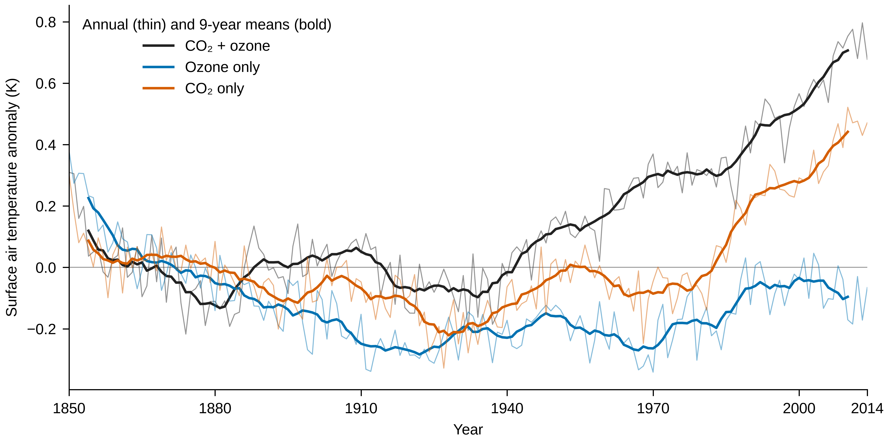

# Historical CO₂ and ozone forcing, 1850–2014

The three experiments use the T21/L10 atmosphere, 16-level ocean, 45-minute step and warm initial state A from the [reference historical experiment](../historical_3d_500y/). The table gives global mean near-surface air temperature (`tas`) anomalies relative to each run’s own 1850–1900 mean. [Maintainer’s request](https://github.com/sunmoumou1/PlaSiC/pull/9#issuecomment-7079546681)

| CO₂ | Ozone | 2005–2014 mean anomaly | 2014 anomaly |
|---|---|---:|---:|
| Historical | Historical | +0.697 K | +0.678 K |
| Fixed at 284.316853 ppmv | Historical | −0.100 K | −0.066 K |
| Historical | Repeated external 1850 seasonal cycle | +0.429 K | +0.471 K |



With the same historical CO₂, the run with historical ozone averaged 0.265 K warmer in 2005–2014 than the run repeating 1850 ozone, comparing absolute temperatures. Each case has one member. The reference state was spun up with idealized ozone, so initial adjustment, drift and internal variability limit attribution of the ozone-only anomaly. [Annual temperatures](fig1/results/annual_temperature.csv) · [Summary](fig1/results/summary.json)

## Inputs and column validation

The four ESGF UReading-CCMI-1-0 `vmro3` files (version `v20160711`) supply 1,980 monthly fields on 66 pressure levels. The converter area-averages source cells onto the Gaussian grid and integrates the profiles between sigma interfaces using twelve reference surface-pressure fields. These come from the first year of a run from `icA.restart` with idealized ozone and fixed 1850 CO₂. The same twelve fields are used in every historical year. [Filenames and SHA256 checksums](SHA256SUMS) · [Dataset identifier](https://hdl.handle.net/21.14100/ab27892c-eaa5-3430-a3c5-f9b0549a556f)

The pipeline checks horizontal area means at every source level and compares all 4,055,040 model-grid columns against direct integration at the same surface pressure. The largest difference in the archived inputs was 0.00002160 DU. During integration, radiation uses instantaneous surface pressure. The L10 top layer contains roughly 75–81% of the column, so its coarse vertical resolution limits estimates of the longwave response and stratospheric heating. [Column check](validate_columns.py) · [Archived radiation and vertical-resolution diagnostics](https://github.com/zsy1207/PlaSiC/blob/feb0c92968712bdced8b636a5f1333cb99dfc154/experiments/ozone_historical/README.md#remapping-and-interpretation)

## Reproduce the runs

With the [build and Python dependencies](../../INSTALL.md#historical-ozone-tools-and-tests) installed, run from the repository root.

```bash
python experiments/ozone_historical/run_pipeline.py --jobs 2
```

The pipeline verifies the four source checksums, builds the two-rank model, prepares and checks the forcing, runs the three cases, then writes the annual CSV, summary and temperature figure under `runs/data_output/fig1/`. Set `--data` and `--output` to select input and run directories. Each job uses two MPI ranks. The historical runner selects 45 minutes explicitly on current builds. The general T21 default is 30 minutes.

For a short run with prepared inputs, pass `--end-year 1850` to [run_experiments.py](run_experiments.py). Rerunning with matching inputs verifies completed years before continuing. New v3 checkpoints require the monthly ozone column (`toz.nc`) and hash every monthly file and the restart. Older v2 checkpoints verify their original file inventory. Version 1 verifies the restart and temperature file. To compare a continuous two-year integration with the annual checkpoints, run [verify_restart.py](verify_restart.py) after completing the combined case through 1851.

The three full integrations used production revision `6f71e17`. Upstream changed the default time step during those runs. Two full-year replays on the subsequent compatibility revision (1850 with joint forcing and 2014 with ozone only) reproduced all 30 monthly files and the final restart in each case. The production archive also contains the original detailed column and Antarctic diagnostics. [Production code](https://github.com/zsy1207/PlaSiC/commit/6f71e172f539831f66e29737e60057854f888dc9) · [Production audit](https://github.com/zsy1207/PlaSiC/blob/feb0c92968712bdced8b636a5f1333cb99dfc154/experiments/ozone_historical/FINAL_REVIEW.md) · [Time-step replays](https://github.com/zsy1207/PlaSiC/blob/ba40655d3690cc064a158393b639dc726a931395/experiments/ozone_historical/README.md#historical-temperature-results)
